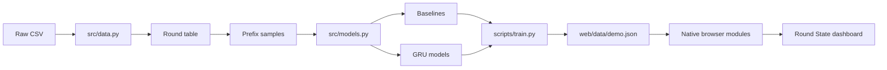

# Round State: VALORANT VCT Map-Win Analytics

## Tiếng Việt

### 1. Giới thiệu

**Round State** là dashboard phân tích VALORANT sau trận. Ứng dụng đọc dữ liệu VCT 2023–2024 và hiển thị xác suất Team A thắng toàn bộ map sau từng round.

Dashboard phục vụ việc xem lại trận đấu, không phải công cụ dự đoán trực tiếp, cá cược, khuyến nghị mua súng hoặc khẳng định quan hệ nhân quả giữa một đặc vụ và kết quả trận.

<div align="center">
  
</div>

<p align="center">
  
</p>

<p align="center"><strong>Round State</strong> đặt việc đọc dữ liệu theo round vào bối cảnh phòng phân tích sau trận của VALORANT.</p>

<p align="center">
  <sub>Hình minh họa: tài sản VALORANT chính thức do Riot Games phát hành. Biểu tượng Wingman lấy từ Valorant API, dựa trên tài sản trong game.</sub>
</p>

<p align="center">
  <a href="https://playvalorant.com/en-us/agents/gekko/">Trang Gekko chính thức</a>
  ·
  <a href="https://playvalorant.com/en-us/agents/">Trang Đặc vụ VALORANT</a>
</p>

### 2. Tính năng

- Responsive cho desktop, tablet và mobile.
- Chuyển tiếng Việt / English, mặc định tiếng Việt.
- Light mode / dark mode, lưu lựa chọn trong `localStorage`.
- Tìm map theo tên map hoặc tên hai đội.
- Xem xác suất sau từng round bằng biểu đồ canvas.
- Di chuột hoặc chạm để xem round, tỷ số và xác suất.
- Kéo timeline hoặc bật phát tự động diễn biến.
- So sánh Logistic Regression, XGBoost, CatBoost, GRU + mean và GRU + agent attention.
- Xem accuracy tại round 6, 12, 18 và calibration curve.
- Có loading, error, retry, empty state, keyboard focus và reduced-motion.

### 3. Kết quả dữ liệu hiện tại

- VCT 2023 dùng cho train và validation.
- VCT 2024 dùng làm test holdout.
- 33.773 dòng round sau khi chuẩn hóa và kiểm tra khóa map.
- 29.015 trạng thái sau round.
- 815 map trong tập test.
- 11 đặc trưng số cho mỗi bước thời gian của GRU.

Mô hình hiển thị chính là **GRU + mean**. Lần chạy hiện tại đạt Log Loss test `0.5273` và ROC-AUC `0.8157`.

### 4. Kiến trúc thư mục

```text
valorant-vct-map-win-analytics/
├── notebooks/01_guided_analysis.ipynb  # Phân tích từng bước
├── src/
│   ├── __init__.py                      # Python package marker
│   ├── data.py                          # Đọc, ghép, chuẩn hóa CSV
│   └── models.py                        # Đặc trưng, GRU, metric
├── scripts/train.py                     # Pipeline huấn luyện
├── web/
│   ├── index.html                       # Semantic shell dashboard
│   ├── css/
│   │   ├── tokens.css                   # Theme tokens light/dark
│   │   ├── base.css                     # Reset, layout, typography
│   │   ├── components.css                # Component styles
│   │   └── responsive.css                # Desktop/tablet/mobile
│   ├── js/
│   │   ├── app.js                       # Bootstrap và event flow
│   │   ├── data-service.js               # Fetch và validate JSON
│   │   ├── state.js                      # Store trạng thái nhẹ
│   │   ├── i18n.js                       # Tiếng Việt / English
│   │   ├── formatters.js                 # Format số và nhãn
│   │   ├── charts.js                     # Probability/calibration chart
│   │   └── ui.js                         # Render giao diện
│   └── data/demo.json                    # Payload đã rút gọn
├── outputs/notebook/                    # Hình/bảng local, không commit
├── requirements.txt
└── README.md
```

### 5. Sơ đồ dữ liệu



### 6. Chuẩn bị Python

Dự án dùng Python Homebrew hiện tại và không tạo virtual environment trong repository.

```bash
/opt/homebrew/opt/python@3.13/libexec/bin/python3 --version
/opt/homebrew/opt/python@3.13/libexec/bin/python3 -m pip install -r requirements.txt
```

Raw CSV không được commit lên repository public. Mặc định script tìm dữ liệu tại:

```text
../RawData/Valorant-Champion-Tour-2021-2026-Data
```

Có thể ghi đè bằng:

```bash
export VALORANT_DATA_ROOT="/duong/dan/tuyet/doi/den/Valorant-Champion-Tour-2021-2026-Data"
```

Mỗi mùa cần có:

```text
vct_2023/matches/maps_scores.csv
vct_2023/matches/eco_rounds.csv
vct_2023/matches/overview.csv
vct_2024/matches/maps_scores.csv
vct_2024/matches/eco_rounds.csv
vct_2024/matches/overview.csv
```

### 7. Chạy notebook

Mở `notebooks/01_guided_analysis.ipynb` bằng VS Code, chọn kernel Python Homebrew rồi chạy từ trên xuống dưới. Hình và bảng tạm được lưu trong `outputs/notebook/`.

### 8. Chạy pipeline

```bash
/opt/homebrew/opt/python@3.13/libexec/bin/python3 scripts/train.py
```

Pipeline đọc và kiểm tra CSV, ghép điểm map/economy/Agent, loại dữ liệu không hợp lệ, tạo prefix theo round, chia dữ liệu theo thời gian, huấn luyện mô hình, tính metric và ghi `web/data/demo.json`.

### 9. Chạy web local

Web là static site, không cần npm hoặc build step:

```bash
/opt/homebrew/opt/python@3.13/libexec/bin/python3 -m http.server 8000 --directory web
```

Mở <http://localhost:8000>. Không mở bằng `file://` vì browser có thể chặn `fetch("data/demo.json")` do CORS.

### 10. GitHub Pages

Repository có thể publish thư mục `web/` bằng GitHub Pages. Push code, vào **Settings → Pages**, chọn workflow `.github/workflows/pages.yml` hoặc source tương ứng. Các đường dẫn của dashboard dùng relative path nên phù hợp với project site.

### 11. Kiểm tra trước khi commit

```bash
node --check web/js/app.js
node --check web/js/ui.js
node --check web/js/charts.js
node --check web/js/i18n.js
git diff --check
```

Kiểm tra thủ công: tải trang, đổi ngôn ngữ, đổi theme, tìm kết quả rỗng, chọn map, kéo slider, phát/tạm dừng, chạm biểu đồ, kiểm tra link và browser console trên desktop/mobile.

### 12. Giới hạn và hướng mở rộng

- Payload web có 24 map đại diện để tải nhanh. Pipeline vẫn tạo được dữ liệu đầy đủ.
- Dashboard hiện là post-match analysis, chưa nhận dữ liệu live.
- Agent đang được dùng ở mức đội hình map, chưa mô hình hóa từng skill hay sự kiện mua skill.
- Có thể bổ sung backend/API, filter tournament, so sánh nhiều map và CI browser smoke test.
- Khi thêm mùa mới cần kiểm tra tên tournament giữa các bảng trước khi merge.

### 13. Nguồn dữ liệu

Ryan Luong, *Valorant Champion Tour 2021-2026 Data*, Kaggle. Thí nghiệm chính sử dụng VCT 2023 và VCT 2024.

Dataset: <https://www.kaggle.com/datasets/ryanluong1/valorant-champion-tour-2021-2023-data>

---

## English

### Overview

**Round State** is a static post-match VALORANT analytics dashboard. It uses VCT 2023–2024 data to show Team A's estimated probability of winning the whole map after each completed round.

The dashboard is built for film-room review. It is not a live prediction service, betting tool, purchase recommender or causal analysis of agent impact.

### Features

- Responsive dashboard for desktop, tablet and mobile.
- Vietnamese and English interface, with Vietnamese as the default.
- Light and dark themes persisted in `localStorage`.
- Map/team search, map selection, probability trajectory and pointer tooltip.
- Round slider, autoplay sequence, model comparison and calibration curve.
- Loading, error, retry and empty-search states.
- Semantic HTML, keyboard focus and reduced-motion support.

### Architecture

The web app intentionally has no runtime dependency or build step. Native ES modules divide data loading, state, i18n, formatting, rendering and charts. The Python pipeline is separate and writes only a small derived payload to `web/data/demo.json`.

```text
src/          Data preparation and model definitions
scripts/      Reproducible training entry point
notebooks/    Guided research notebook
web/js/       Browser modules by responsibility
web/css/      Theme, base, components and responsive styles
web/data/     Derived demo payload only
```

### Run

```bash
/opt/homebrew/opt/python@3.13/libexec/bin/python3 -m pip install -r requirements.txt
/opt/homebrew/opt/python@3.13/libexec/bin/python3 scripts/train.py
/opt/homebrew/opt/python@3.13/libexec/bin/python3 -m http.server 8000 --directory web
```

Open <http://localhost:8000>.

### Data split

- VCT 2023: training and validation.
- VCT 2024: final test holdout.
- 33,773 validated round rows.
- 29,015 post-round prefix states.
- 815 held-out maps.
- 11 numeric round features for the GRU sequence.

### Production notes

Before a real internal deployment, add CI checks for JavaScript syntax, payload schema, browser smoke tests at desktop/mobile viewports, accessibility and GitHub Pages artifact paths. Keep raw CSV and report documents outside the public repository.

### Data source

Ryan Luong, *Valorant Champion Tour 2021-2026 Data*, Kaggle.

Dataset: <https://www.kaggle.com/datasets/ryanluong1/valorant-champion-tour-2021-2023-data>
